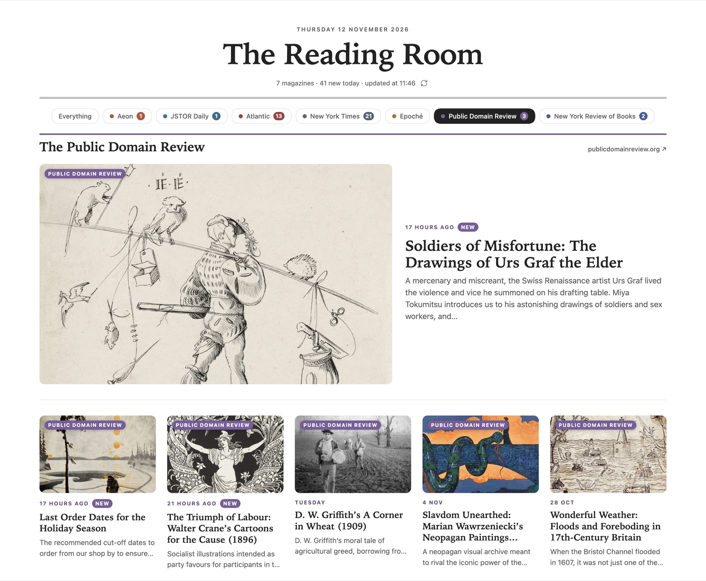

<h1 align="center">Magazine Rack</h1>

<p align="center"><strong>The Reading Room: a front page for the magazines you read, inside Obsidian.</strong></p>

<p align="center">
  <a href="https://github.com/CasaAmarillaRoja/reading_room/releases/latest"></a>
  
  
</p>

<p align="center">
  <picture>
    <source media="(prefers-color-scheme: dark)" srcset="docs/front-page-dark.jpg">
    
  </picture>
</p>

Magazine Rack turns one note into a page you want to open: the newest pieces from the magazines you follow, each with its picture, headline, standfirst and author, laid out like the front of a magazine. Click a story and it opens in your browser. The page keeps itself up to date while Obsidian is open.

It comes set up with seven magazines: **Aeon**, **JSTOR Daily**, **The Atlantic**, **The New York Times**, **Epoché**, **The Public Domain Review** and **The New York Review of Books**. You can add any other magazine, newspaper, journal or blog that publishes a feed, which is almost all of them.

## What is on the page

- **A masthead** with today's date, the page title, how many pieces are new today, when it last checked, and a refresh button.
- **A chip for each magazine**, with a count of today's unread pieces. Click one to see only that magazine, with everything kept for it; click *Everything* to go back.
- **Just in**: the newest piece across all your magazines as a large lead story, with the next four beside it.
- **A section for each magazine**, in its own colour. Its newest article leads, picture beside the words, followed by a grid of cards.
- **A tag on every picture** naming the magazine, so you always know where a piece comes from.
- **New and read.** Pieces from the last 24 hours carry a *New* badge until you open them. Opened pieces are dimmed and marked *Read*.
- **No picture, no gap.** An article without one gets a plate with the magazine's initials on its colour.

The page takes its colours from your theme, so it looks at home in light mode, dark mode and any community theme.

## On your phone


The layout follows the width of the pane, not the device, so it works on a phone, on a tablet and in a narrow side pane on the desktop.

On a narrow screen the chips scroll sideways and the chosen one stays in view. Each magazine's lead story keeps its full picture, and the rest become rows with a square thumbnail, the magazine's name and when the piece was published.

Everything runs in Obsidian itself, on desktop and mobile alike. There is no server and no account.

<br clear="right">

## Adding a magazine

Open **Settings → Magazine Rack**. Above the list of magazines there is a short guide:

<p align="center"></p>

1. **Press *Add a magazine*.** Type its name and its website address, for example `https://www.lrb.co.uk`.
2. **Press *Find the feed*.** The plugin reads the feed the site announces in its pages, and tries the usual addresses if it announces none.
3. **If nothing is found,** search the web for the magazine's name followed by *RSS feed*, or try the website address followed by `/feed`, `/rss` or `/rss.xml`. Paste what you find into *Feeds*. Sections of a site often have feeds of their own: put several on separate lines and they are merged into one section, newest first.
4. **Press *Test the feeds*.** Each address reports how many articles it holds, its newest headline, and whether the feed carries pictures. *The site sent a web page instead of the feed* means that address is not a feed.
5. **Save.** The new section appears a few seconds later.

<p align="center"></p>

Two tips. If every article shows the same author, the feed is naming its editor rather than its writers: switch off *Show authors* for that magazine. And paywalled magazines work too: the page links to each article, and you read it with your own subscription.

## Where the pictures come from

From the feed, where it carries them. Where it does not (Epoché and The New York Review of Books, for example), Magazine Rack reads the picture each article page offers for sharing, once per article, and remembers it. A site that refuses that request gets the initials plate instead.

## The magazines it starts with

| Magazine | Feed |
| --- | --- |
| Aeon | `https://aeon.co/essays/feed.rss`. Essays only; the main feed is half videos. |
| JSTOR Daily | `https://daily.jstor.org/feed/` |
| The Atlantic | `https://www.theatlantic.com/feed/all/` |
| The New York Times | `https://rss.nytimes.com/services/xml/rss/nyt/HomePage.xml` (top stories) |
| Epoché Magazine | `https://epochemagazine.org/feed/` |
| The Public Domain Review | `https://publicdomainreview.org/rss.xml` |
| The New York Review of Books | `https://www.nybooks.com/feed/?post_type=article` (the print issue) and `https://www.nybooks.com/feed/?post_type=daily` (the online pieces), merged. The site's main feed is empty. |

Authors are hidden for Epoché and The New York Review of Books, because their feeds name the editor who posted each piece. Switch any magazine off, reorder the list or remove what you do not read.

## Settings

| Setting | What it does |
| --- | --- |
| Note | Where the page lives. The default is `Reading Room.md`, made the first time you open it. |
| Page title | The name across the top. The default is *The Reading Room*. |
| Articles per magazine | 3 to 30. The default of 9 gives a lead story and two full rows of four. |
| Check for new articles | Every 15 minutes to every 12 hours; every hour by default. It also checks when Obsidian starts, if the last check is older than that. |
| Show standfirsts | The short introduction under each headline. |
| Magazines | Switch each on or off, reorder, edit (name, website, feeds, colour, authors), remove or add. |

Two commands, *Open the reading room* and *Check for new articles now*, and a newspaper icon in the left ribbon that opens the page.

## The page in other notes

The note holds a single code block, and you can put the same block in any other note, a daily note or a dashboard. Two optional lines narrow it down:

````markdown
```magazine-rack
magazines: Aeon, JSTOR Daily
articles: 6
```
````

The articles are kept in the plugin's data file (`.obsidian/plugins/magazine-rack/data.json`), so the note itself never changes when new pieces arrive. If your vault is under git, you may want to ignore that file, since it changes at every check.

## Install

**With BRAT.** Install the [BRAT](https://github.com/TfTHacker/obsidian42-brat) plugin, choose *Add beta plugin*, and enter `CasaAmarillaRoja/reading_room`.

**By hand.** Download `main.js`, `manifest.json` and `styles.css` from the [latest release](https://github.com/CasaAmarillaRoja/reading_room/releases/latest) into `<your vault>/.obsidian/plugins/magazine-rack/`.

Then switch on **Magazine Rack** in Settings → Community plugins, and click the newspaper icon in the left ribbon.

## Privacy

Magazine Rack talks only to the magazines you list: their feeds, their article pages (for pictures) and their image servers. It has no account, no analytics and no server of its own. The list of articles it keeps is stored in the plugin's data file inside your vault.

## Building from source

```bash
npm install
```

```bash
npm run build
```

This writes `main.js` next to `manifest.json` and `styles.css`.
