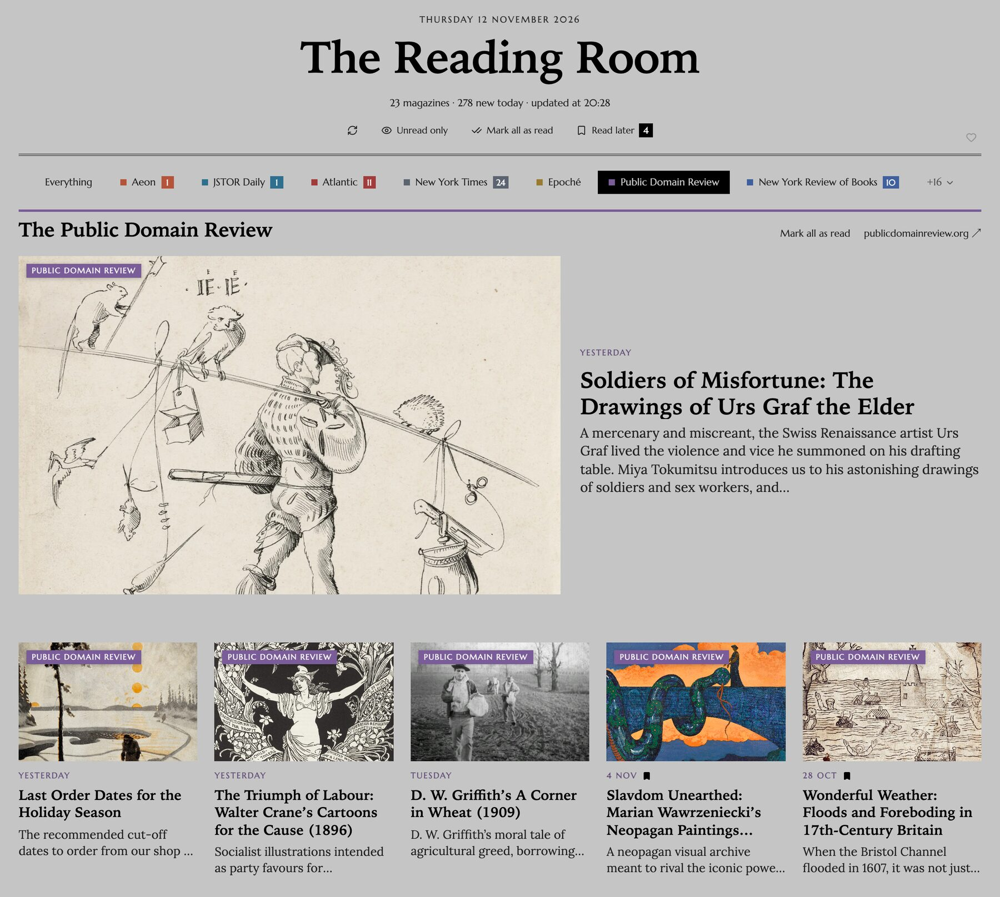
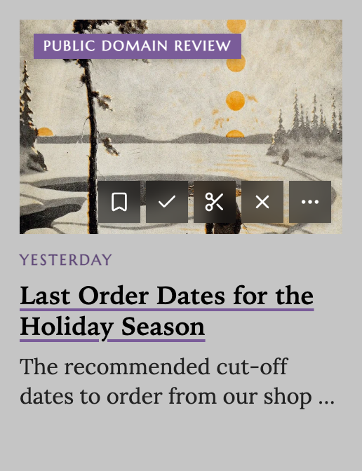
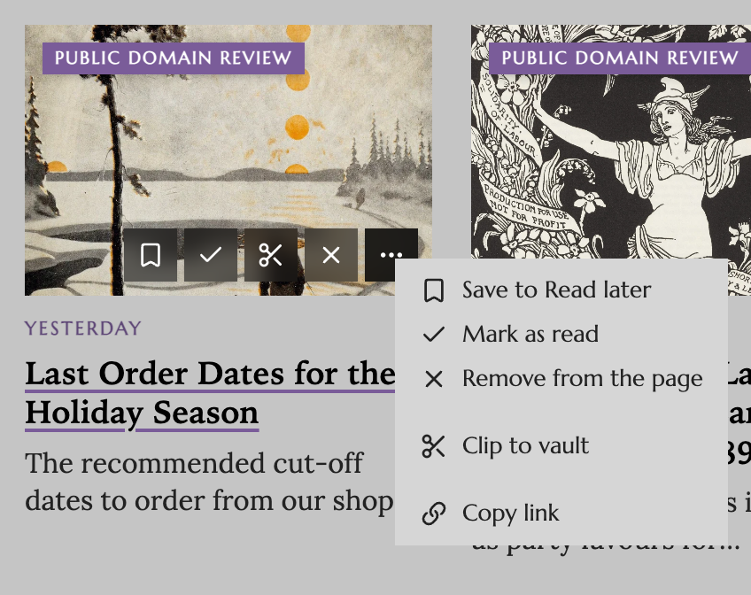
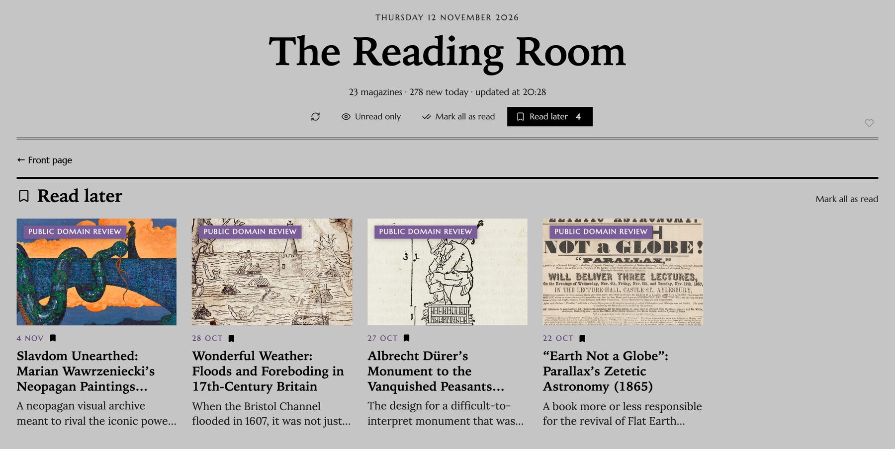
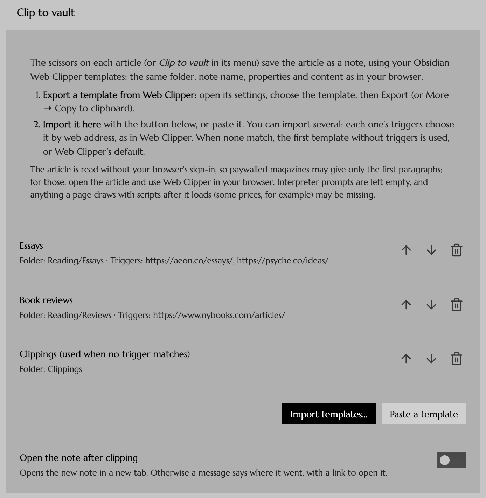
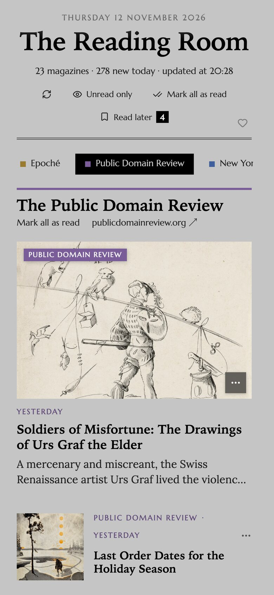
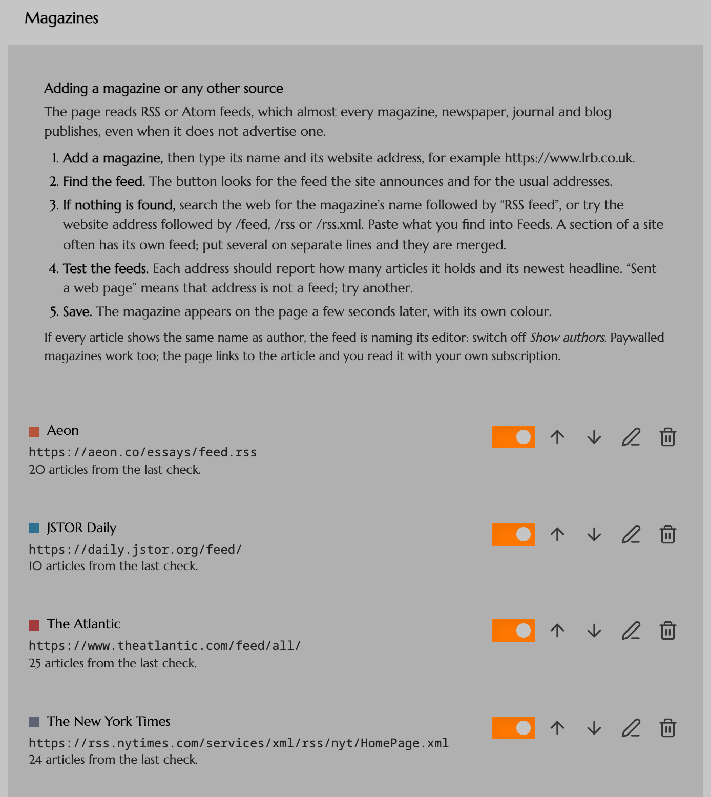
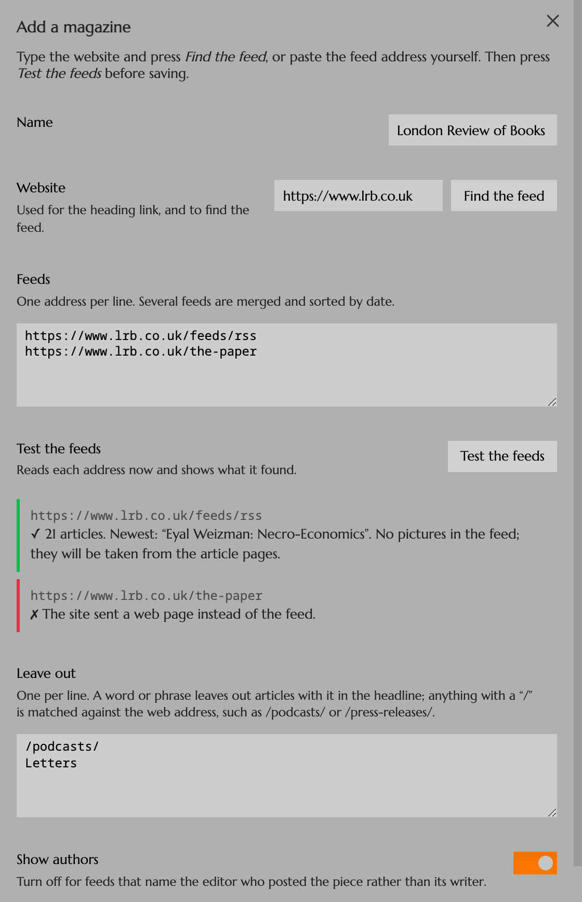

<h1 align="center">Magazine Rack</h1>

<p align="center"><strong>The Reading Room: a front page for the magazines you read, inside Obsidian.</strong></p>

<p align="center">
  <a href="https://github.com/DuckTapeKiller/magazine-rack/releases/latest"></a>
  
  
  
  <a href="https://ko-fi.com/ducktapekiller"></a>
</p>

<p align="center">
  
</p>

Magazine Rack turns one note into a page you want to open: the newest pieces from the magazines you follow, each with its picture, headline, standfirst and author, laid out like the front of a magazine. Click a story and it opens in your browser. Save it to read later, mark it read, take it off the page, or clip it into your vault with your Obsidian Web Clipper templates. The page keeps itself up to date while Obsidian is open.

It comes set up with twenty-three sources in English, Spanish and French: magazines such as **Aeon**, **The Atlantic**, **Psyche**, **Noema**, **Granta**, **Letras Libres** and **The New York Review of Books**, and newspapers such as **The Guardian**, **Le Monde**, **El País** and **La Nación** (the full list is below). Switch off what you do not read, and add any other magazine, newspaper, journal or blog that publishes a feed, which is almost all of them.

## What is on the page

- **A masthead** with today's date, the page title, how many pieces are new today and when it last checked, with four buttons: check now, *Unread only*, *Mark all as read*, and *Read later*, which opens your reading list.
- **A chip for each magazine**, with a count of its unread pieces from the last 24 hours. Click one to see only that magazine; click *Everything* to go back. With many magazines the row folds to a single line, ending in a chip such as *+16* that unfolds the rest and *Show fewer* that folds them again; the page remembers which you chose, and the magazine you are reading always stays in view.
- **Just in**: the newest piece across all your magazines as a large lead story, with the next four beside it.
- **A section for each magazine**, in its own colour. Its newest article leads, picture beside the words, followed by a grid of cards.
- **A tag on every picture** naming the magazine, so you always know where a piece comes from.
- **New and read.** Pieces from the last 24 hours carry a *New* badge until you open them. Opened pieces are dimmed and marked *Read*.
- **No picture, no gap.** An article without one gets a plate with the magazine's initials on its colour.

The page takes its colours and its corners from your theme, so it looks at home in light mode, dark mode and any community theme: in a theme with square corners, such as Brutalist, its buttons, chips and pictures are square too. It can speak English or Spanish: the dates, labels and menus follow the language you choose in the settings.

## Save, read, remove, clip

<p align="center">
  
  &nbsp;&nbsp;&nbsp;
  
</p>

Point at a card and five buttons appear on its picture:

- **Save to Read later**, which puts the piece on your reading list (see below);
- **Mark as read**, or unread again;
- **Clip to vault** (see below);
- **Remove**, which takes the piece off the page;
- **More**, which opens the menu with everything above, a *Clip with…* entry for each of your templates, and *Copy link*.

Right-clicking a card opens the same menu. On a phone or tablet the picture shows only the menu button, and the small rows have it at the end of their label line. Saving, removing and *Mark all as read* each show a message with **Undo**.

## Read later

<p align="center"></p>

The pieces you save wait on a page of their own, away from the news. Press *Read later* in the masthead to open it, and *Front page* (or *Read later* again) to go back; the button shows how many pieces are waiting. They stay until you take them off, even after they leave the magazine's feed, and the cross on a card, or *Remove from Read later* in its menu, takes one off, with **Undo**.

*Unread only* hides everything you have read, across the whole page and the reading list. *Mark all as read* in the masthead covers what the page is showing; each section has its own as well.

Feeds only hold their newest pieces, and a busy one such as *The New York Times*' top stories moves on within hours. So the page keeps every article for a week after it leaves its feed, or for as long as you choose.

## Clip to vault with your Web Clipper templates

<p align="center"></p>

The scissors save an article as a note in your vault, using your [Obsidian Web Clipper](https://obsidian.md/clipper) templates: the same folder, note name, properties and content you get in your browser.

1. **In Web Clipper's settings**, open a template and choose *Export* (or *More → Copy to clipboard*).
2. **In Settings → Magazine Rack → Clip to vault**, press *Import templates…*, or *Paste a template*. Import as many as you like.

Each template's **triggers** pick it by web address, as in Web Clipper, so an essay from Aeon can go to one folder and a review to another. When no trigger matches, the first template without triggers is used; until you import one, clips use Web Clipper's own default template, a note in *Clippings*. All of Web Clipper's ways of saving work: a new note, overwrite, add to the top or bottom of a note, or add to today's daily note.

Magazine Rack fills templates with the two libraries Web Clipper itself is built on: [Defuddle](https://github.com/kepano/defuddle), which finds the article in the page and turns it into Markdown, and [Knap](https://github.com/obsidianmd/knap), Web Clipper's template language, with all its variables, filters and logic. On Web Clipper's own six test pages, Magazine Rack produces the same notes as Web Clipper, apart from one timestamp written in the local time zone.

Three things it cannot do that Web Clipper in your browser can:

- **Paywalled articles.** It reads the page without your browser's sign-in, so a subscriber-only article may come through as its opening paragraphs, and a site may refuse it outright. Magazine Rack tells you when the text looks short. For those, open the article and use Web Clipper in your browser.
- **Things a page draws with scripts after it loads**, such as some prices, may be missing.
- **Interpreter prompts** (Web Clipper's AI variables) are left empty, and there are no highlights to include.

## On your phone



The layout follows the width of the pane, not the device, so it works on a phone, on a tablet and in a narrow side pane on the desktop.

On a narrow screen the chips stay on one line that scrolls sideways, and the chosen one stays in view. Each magazine's lead story keeps its full picture, and the rest become rows with a square thumbnail, the magazine's name and when the piece was published.

Everything runs in Obsidian itself, on desktop and mobile alike. There is no server and no account.

The note opens in reading view each time, even in vaults that open notes for editing. If you switch it to editing on purpose, it stays that way until you next open it.

<br clear="right">

## Adding a magazine

Open **Settings → Magazine Rack**. Above the list of magazines there is a short guide:

<p align="center"></p>

1. **Press *Add a magazine*.** Type its name and its website address, for example `https://www.lrb.co.uk`.
2. **Press *Find the feed*.** The plugin reads the feed the site announces in its pages, and tries the usual addresses if it announces none.
3. **If nothing is found,** search the web for the magazine's name followed by *RSS feed*, or try the website address followed by `/feed`, `/rss` or `/rss.xml`. Paste what you find into *Feeds*. Sections of a site often have feeds of their own: put several on separate lines and they are merged into one section, newest first.
4. **Press *Test the feeds*.** Each address reports how many articles it holds, its newest headline, and whether the feed carries pictures. *The site sent a web page instead of the feed* means that address is not a feed.
5. **Leave out** what you never read, if you like: a word or phrase drops articles with it in the headline, and anything with a `/` is matched against the web address, such as `/podcasts/`.
6. **Save.** The new section appears a few seconds later.

<p align="center"></p>

Two tips. If every article shows the same author, the feed is naming its editor rather than its writers: switch off *Show authors* for that magazine. And paywalled magazines work too: the page links to each article, and you read it with your own subscription.

## Where the pictures come from

From the feed, where it carries them. Where it does not (Epoché, Nature and The New York Review of Books, for example), Magazine Rack reads the picture each article page offers for sharing and remembers it. It does the same when a feed's pictures are only small thumbnails, as the BBC's are, so the large cards stay sharp. A page that gives no picture is tried again at the next two checks, since some sites fail now and then; after that the article gets the initials plate.

## The magazines it starts with

| Magazine | Feed |
| --- | --- |
| Aeon | `https://aeon.co/essays/feed.rss`. Essays only; the main feed is half videos. |
| JSTOR Daily | `https://daily.jstor.org/feed/` |
| The Atlantic | `https://www.theatlantic.com/feed/all/` |
| The New York Times | `https://rss.nytimes.com/services/xml/rss/nyt/HomePage.xml` (top stories) |
| Epoché Magazine | `https://epochemagazine.org/feed/` |
| The Public Domain Review | `https://publicdomainreview.org/rss.xml` |
| The New York Review of Books | `https://www.nybooks.com/feed/?post_type=article` (the print issue) and `https://www.nybooks.com/feed/?post_type=daily` (the online pieces), merged. The site's main feed is empty. |
| The Guardian | `https://www.theguardian.com/world/rss` (world news) |
| Le Monde | `https://www.lemonde.fr/rss/une.xml` (front page) |
| El País | `https://feeds.elpais.com/mrss-s/pages/ep/site/elpais.com/portada` (front page) |
| El Espectador | `https://www.elespectador.com/arc/outboundfeeds/discover/` |
| La Nación | `https://www.lanacion.com.ar/arc/outboundfeeds/rss/` |
| BBC | `https://feeds.bbci.co.uk/news/rss.xml` (top stories) |
| Epoch Times | `https://feed.theepochtimes.com/us/feed` |
| Psyche | `https://psyche.co/feed`. It includes Psyche's films; add `/videos/` to *Leave out* to keep only the writing. |
| Nature | `https://www.nature.com/nature.rss` |
| Big Think | `https://bigthink.com/feed/` |
| Noema | `https://www.noemamag.com/feed/` |
| Letras Libres | `https://letraslibres.com/feed/` |
| Zenda | `https://www.zendalibros.com/feed/` |
| El Cultural | `https://www.elespanol.com/rss/el-cultural/` |
| McSweeney’s | `https://feeds.feedburner.com/mcsweeneys` |
| Granta | `https://grantamag.substack.com/feed`, Granta's own Substack. granta.com turns away anything that is not a browser, so its pages cannot be read. |

Authors are hidden for Epoché, The New York Review of Books and Granta, because their feeds name the editor who posted each piece, or the magazine itself. Switch any magazine off, reorder the list or remove what you do not read.

## Settings

| Setting | What it does |
| --- | --- |
| Note | Where the page lives. The default is `Reading Room.md`, made the first time you open it. |
| Page title | The name across the top. The default is *The Reading Room*. |
| Articles per magazine | 3 to 30. The default of 9 gives a lead story and two full rows of four. |
| Check for new articles | Every 15 minutes to every 12 hours; every hour by default. It also checks when Obsidian starts, if the last check is older than that. |
| Show standfirsts | The short introduction under each headline. |
| Keep articles for | How long an article stays after it leaves its feed: from not at all to a month; a week by default. |
| Language of the page | English or Spanish, for the dates, labels and menus on the page. The settings stay in English. |
| Always open in reading view | Switches the note to reading view each time it opens. On by default. |
| Magazines | Switch each on or off, reorder, edit (name, website, feeds, what to leave out, colour, authors), remove or add. |
| Clip to vault | Import, order and remove Web Clipper templates, and choose whether a clipped note opens straight away. |

Two commands, *Open the reading room* and *Check for new articles now*, and a newspaper icon in the left ribbon that opens the page.

## The page in other notes

The note holds a single code block, and you can put the same block in any other note, a daily note or a dashboard. Two optional lines narrow it down:

````markdown
```magazine-rack
magazines: Aeon, JSTOR Daily
articles: 6
```
````

The articles, your reading list and what you have read are kept in the plugin's data file (`.obsidian/plugins/magazine-rack/data.json`), so the note itself never changes when new pieces arrive. If your vault is under git, you may want to ignore that file, since it changes at every check.

## Install

**With BRAT.** Install the [BRAT](https://github.com/TfTHacker/obsidian42-brat) plugin, choose *Add beta plugin*, and enter `DuckTapeKiller/magazine-rack`.

**By hand.** Download `main.js`, `manifest.json` and `styles.css` from the [latest release](https://github.com/DuckTapeKiller/magazine-rack/releases/latest) into `<your vault>/.obsidian/plugins/magazine-rack/`.

Then switch on **Magazine Rack** in Settings → Community plugins, and click the newspaper icon in the left ribbon.

## Privacy

Magazine Rack talks only to the magazines you list: their feeds, their article pages (for pictures, and when you clip an article) and their image servers. It has no account, no analytics and no server of its own. What it keeps is stored in the plugin's data file inside your vault.

## Support

Magazine Rack is free and open source. If it is useful to you, you can support its development on [Ko-fi](https://ko-fi.com/ducktapekiller): there is a small heart, beating softly, in the corner of the page's masthead, and a *Support* section at the end of the settings.

## Building from source

```bash
npm install
```

```bash
npm run build
```

This type-checks the code, runs Obsidian's official plugin lint ([eslint-plugin-obsidianmd](https://github.com/obsidianmd/eslint-plugin)) with no warnings allowed, and writes `main.js` next to `manifest.json` and `styles.css`. `npm run lint` runs the lint alone.

Magazine Rack bundles Defuddle, Knap and Day.js, and Defuddle's full build includes Turndown and mathml-to-latex. All are MIT-licensed; see [THIRD_PARTY_NOTICES.md](THIRD_PARTY_NOTICES.md).

## Author and licence

Made by **DuckTapeKiller**. Released under the [MIT licence](LICENSE).
